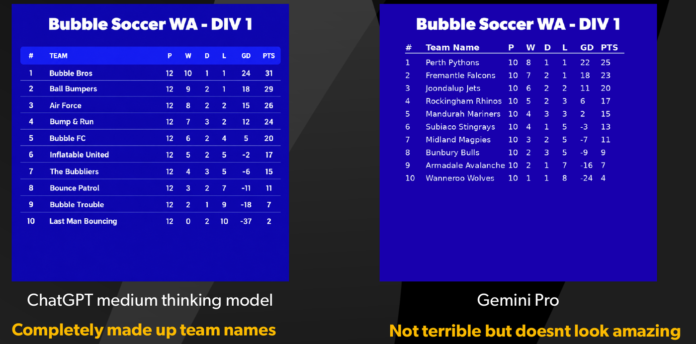

# ECU AI Automation Demo – Ladder Graphics

Turns a league ladder spreadsheet into a ready-to-post 1080×1080 social media graphic.

Built as a live demo for a guest lecture at Edith Cowan University (ECU). 📑 [View the lecture slides](docs/slides.pdf)

<p align="center">
  
</p>


## Why I built it

Sporting organisations post fixture and ladder graphics for every division, every week. Done by hand in Photoshop, that can mean hundreds of small text edits a week. That's slow and repetitive, and with that many edits, a typo somewhere is almost guaranteed.

At Football West, I automated our real fixtures and ladders graphics, which cut about 4–5 hours of manual work a week to under a minute. For a guest lecture on tech, data and AI at ECU, I rebuilt a simplified version of that idea as a live demo, and set students this brief:

> You've just joined the marketing team at a brand-new state sporting body, **Bubble Soccer WA**. The CEO wants fixtures and ladders posted for 10+ divisions every week of the season. How would you automate it?

## Where AI fits in

The tempting answer is "just ask an AI to make the graphic." In the lecture, I gave the same ladder to two chatbots:



- **ChatGPT** (medium thinking model) made up its own team names and results.
- **Gemini Pro** kept the data right, but the design didn't come close to a finished graphic.

Image generation is a black box: run it twice and you get two different results, with no guarantee every number is correct. A script is the opposite. It's repeatable, every number comes straight from the data, and changing a font, colour or column position is a one-line edit.

The takeaway: don't use AI to *be* the automation, use it to help you *build* the automation. Frontier AI coding models now make it realistic for one or two people to build production-ready internal tools, without a team of developers or a big budget. Review and test AI-generated code before you trust it.

## Features

- **Upload your own data and background:** any CSV in the format below, on any PNG or JPG template
- **Edit in place:** fix scores or add teams in an editable table, and the preview updates instantly
- **Auto-sort:** orders teams by points, then goal difference, and renumbers positions
- **Fits any league size:** rows shrink to fit when there are more than 10 teams
- **One-click download:** a full-resolution 1080×1080 PNG, ready for Instagram or Facebook
- **Notebook walkthrough:** [`ladder_graphic.ipynb`](ladder_graphic.ipynb) builds the graphic step by step, as presented in the lecture

## Quick start

Requires Python 3.10+.

```bash
python -m venv .venv
source .venv/bin/activate        # Windows: .venv\Scripts\activate
pip install -r requirements.txt
streamlit run app.py
```

The app opens at http://localhost:8501 with sample data loaded. To follow the notebook instead, run `jupyter notebook ladder_graphic.ipynb`.

## CSV format

| index | teamname      | p  | w | d | l | gd | pts |
|-------|---------------|----|---|---|---|----|-----|
| 1     | Perth Pythons | 10 | 8 | 1 | 1 | 22 | 25  |

`p/w/d/l` are played/won/drawn/lost, `gd` is goal difference and `pts` is points. See [`data/div1_ladder.csv`](data/div1_ladder.csv) for a full example.

## How it works

[`ladder.py`](ladder.py) holds all the drawing logic, and both the Streamlit app and the notebook use it. It draws the table (header, striped rows and a highlighted points column) onto a transparent RGBA overlay using Pillow. It then alpha-composites that overlay onto the template, so the background shows through. Column positions are defined once in a small layout table (`COLUMNS`). Poppins is bundled in `assets/fonts/`, so the output looks identical on macOS, Windows and Linux.

```
├── app.py                 # Streamlit web app (upload → edit → preview → download)
├── ladder.py              # Shared rendering code
├── ladder_graphic.ipynb   # Step-by-step lecture walkthrough
├── data/                  # Sample ladder CSV
├── assets/                # Background template and bundled fonts
└── docs/                  # Lecture slides and screenshots
```

## Tech

Python · Streamlit · pandas · Pillow · Jupyter

## Notes

The teams, results and "Bubble Soccer WA" branding are fictional sample data made for the demo.

Code is released under the [MIT License](LICENSE). Poppins is used under the [SIL Open Font License](assets/fonts/OFL.txt).
