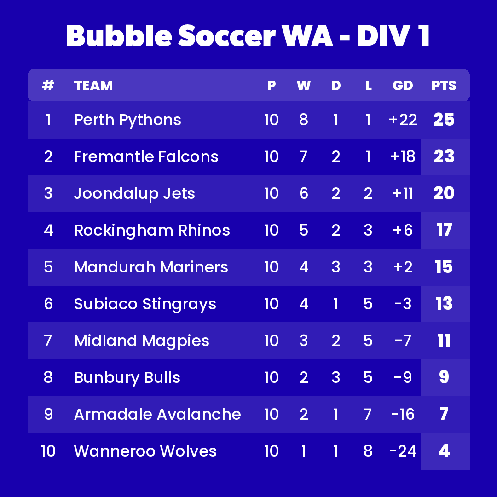
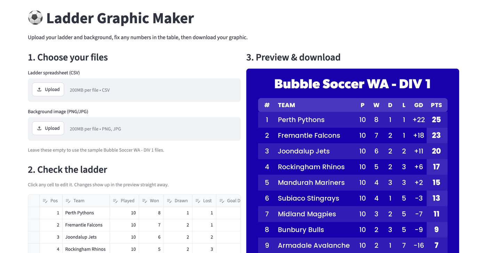

# ECU AI Automation Demo – Ladder Graphics

Turns a league ladder spreadsheet into a ready-to-post 1080×1080 social media graphic.

Built as a live demo for a guest lecture at Edith Cowan University (ECU).

<p align="center">
  
</p>



## Why I built it

Every week, club and league staff rebuild ladder graphics by hand: they copy the standings out of a spreadsheet, retype them into a design tool and check every number. It's slow, repetitive and easy to get wrong. This project automates that job. You drop in the CSV, fix anything in the browser, and download a finished, on-brand graphic in seconds.

## Features

- **Upload your own data and background:** any CSV in the format below, on any PNG or JPG template
- **Edit in place:** fix scores or add teams in an editable table, and the preview updates instantly
- **Auto-sort:** orders teams by points, then goal difference, and renumbers positions
- **Fits any league size:** rows shrink to fit when there are more than 10 teams
- **One-click download:** a full-resolution 1080×1080 PNG, ready for Instagram or Facebook
- **Notebook walkthrough:** [`ladder_graphic.ipynb`](ladder_graphic.ipynb) builds the graphic step by step, as presented in the lecture

## Quick start

Requires Python 3.10+.

```bash
python -m venv .venv
source .venv/bin/activate        # Windows: .venv\Scripts\activate
pip install -r requirements.txt
streamlit run app.py
```

The app opens at http://localhost:8501 with sample data loaded. To follow the notebook instead, run `jupyter notebook ladder_graphic.ipynb`.

## CSV format

| index | teamname      | p  | w | d | l | gd | pts |
|-------|---------------|----|---|---|---|----|-----|
| 1     | Perth Pythons | 10 | 8 | 1 | 1 | 22 | 25  |

`p/w/d/l` are played/won/drawn/lost, `gd` is goal difference and `pts` is points. See [`data/div1_ladder.csv`](data/div1_ladder.csv) for a full example.

## How it works

[`ladder.py`](ladder.py) holds all the drawing logic, and both the Streamlit app and the notebook use it. It draws the table (header, striped rows and a highlighted points column) onto a transparent RGBA overlay using Pillow. It then alpha-composites that overlay onto the template, so the background shows through. Column positions are defined once in a small layout table (`COLUMNS`). Poppins is bundled in `assets/fonts/`, so the output looks identical on macOS, Windows and Linux.

```
├── app.py                 # Streamlit web app (upload → edit → preview → download)
├── ladder.py              # Shared rendering code
├── ladder_graphic.ipynb   # Step-by-step lecture walkthrough
├── data/                  # Sample ladder CSV
├── assets/                # Background template and bundled fonts
└── docs/                  # Screenshots
```

## Tech

Python · Streamlit · pandas · Pillow · Jupyter

## Notes

The teams, results and "Bubble Soccer WA" branding are fictional sample data made for the demo.

Code is released under the [MIT License](LICENSE). Poppins is used under the [SIL Open Font License](assets/fonts/OFL.txt).
